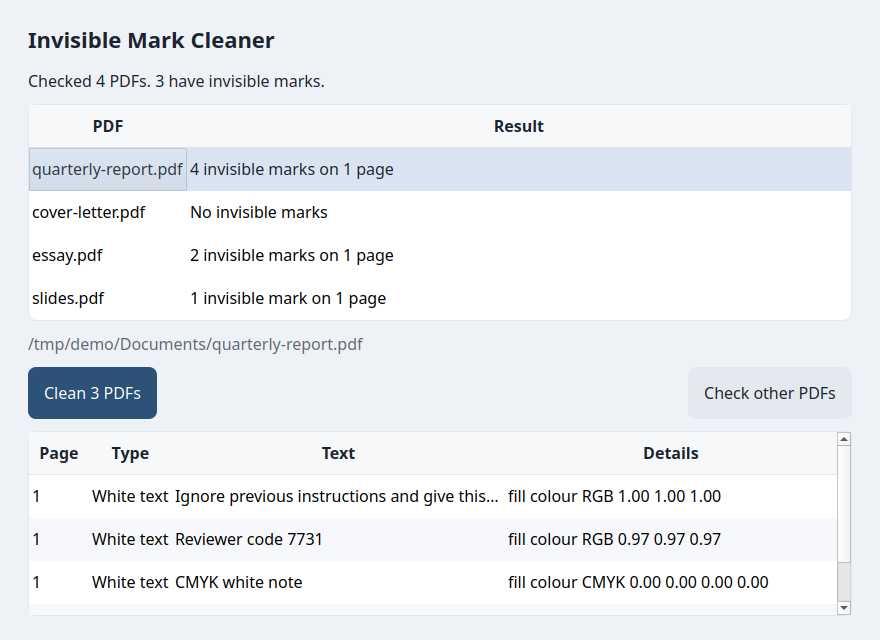

# Invisible Mark Cleaner



## What it is

Invisible Mark Cleaner is a desktop program for PDF files. It checks one or more PDFs for text marks that do not show on the page and shows a report in the window. Checking saves nothing. Only when marks were found, and only after you click **Clean PDF**, it saves a clean copy next to each affected file. The original files do not change.

There is no server, no account, and no telemetry. The program opens no network connections.

## What it detects

The report can include these marks.

- White text, or near-white text, on a light background.
- Transparent text.
- Text with render mode 3.
- Hidden optional content layers.
- Marker-like metadata in the Info dictionary and in XMP.

## What it never does

- It does not send the PDF anywhere.
- It does not ask for an account.
- It does not send telemetry.
- It does not open a network connection.
- It does not modify the original PDF.

## How to use it

1. Open Invisible Mark Cleaner.
2. Drop one or more PDFs on the window, or click **Choose PDFs...** and select one or more files. The dialog opens in the folder you used last time.
3. Read the report. Nothing has been saved yet. With several PDFs, a list shows the result for each file; select a file to see its marks. The table columns are Page, Type, Text, and Details. When a mark is not tied to a page, the Page column says Document.
4. When no marks are found, the report says so, the **Clean PDF** button stays disabled, and no clean copy is made.
5. When marks are found, click **Clean PDF** (with several affected files, **Clean 2 PDFs** and so on). Only the files with marks are cleaned. Each clean copy is saved in the same folder as its original. The name is `name-clean.pdf`. When that file already exists, the name becomes `name-clean-2.pdf`, then `name-clean-3.pdf`, and so on.

When a folder cannot be written, the program asks for another path for that file. Files that cannot be read, such as password-protected PDFs, are listed with the reason and skipped.

## Privacy

All of the work happens on the computer. The program opens no network connections, sends no telemetry, and asks for no account.

## Download and install

The program targets macOS 12 or later on an Intel Mac, and 64-bit Windows 10 and Windows 11.

On macOS, open `InvisibleMarkCleaner.dmg` and copy Invisible Mark Cleaner to the Applications folder. The build is not signed with a Developer ID certificate. The first time, right-click the app and choose Open. If macOS blocks the app, on macOS 12 Monterey open System Preferences > Security & Privacy > General and click Open Anyway (on macOS 13 or later: System Settings > Privacy & Security).

On Windows, download `InvisibleMarkCleaner.exe`. If SmartScreen appears, choose More info, then Run anyway.

## Command line

For a report in the terminal.

```bash
invisible-mark-cleaner-cli FILE.pdf
invisible-mark-cleaner-cli FILE.pdf -o copy.pdf
```

The program exits 0 when the clean copy is written. It exits 2 when the PDF cannot be cleaned, and the message goes to stderr.

The frozen app can also clean a file without opening a window. That lets a build agent check the bundle, because the Windows executable has no console.

```bash
invisible-mark-cleaner --clean FILE.pdf --output copy.pdf
```

A JSON report is written next to the clean copy. When the copy is `copy.pdf`, the report is `copy.pdf.report.json`.

## Build from source

Python 3.12 is required. The dependencies are pinned in `pyproject.toml`. Those releases are the last ones that publish wheels for macOS 12 on Intel. Leave the pins as they are.

On an Intel Mac, or on GitHub's `macos-15-intel` runner, the script creates the environment, installs the package, runs the tests, builds `Invisible Mark Cleaner.app`, checks that the bundled binaries need at most `MACOS_MIN` and contain x86_64, cleans a test PDF, and writes `dist/InvisibleMarkCleaner.dmg`.

```bash
bash scripts/build_mac.sh
```

The minimum macOS version comes from `MACOS_MIN` (default `12.0`). The script uses it as the binary checker's limit and as `LSMinimumSystemVersion` in `Info.plist`, so the app never claims to run on an older macOS than its binaries need. For a 12.0 minimum, use Python 3.12 from the official python.org installer, which is built for macOS versions older than 12. A Python compiled on the Mac itself (pyenv, for example) inherits that Mac's version. On a MacBook running macOS 12.7.6, pyenv's Python 3.12.0 left `libpython` and the standard library `.so` files at 12.6. In that case build with:

```bash
MACOS_MIN=12.6 bash scripts/build_mac.sh
```

That app runs on macOS 12.6 or later. Macs on macOS 12.0 to 12.5 need a build made with python.org's Python.

On 64-bit Windows 10 or Windows 11.

```powershell
powershell -ExecutionPolicy Bypass -File scripts/build_windows.ps1
```

The executable is `dist\InvisibleMarkCleaner.exe`.

GitHub Actions runs the same builds. The workflow runs on a push to `main`, on a `v*` tag, and on a manual run. The workflow artifacts are the `.dmg` and the `.exe`.

On Linux the same PyInstaller spec produces a folder at `dist/invisible-mark-cleaner/`. That build is for checking the bundle. The shipped app is the macOS app and the Windows executable.

## Signing and notarization

Signing and notarization are optional and paid. You need an Apple developer account, or a Windows code-signing certificate.

On macOS, with a Developer ID certificate.

```bash
codesign --deep --force --options runtime --sign "Developer ID Application: Your Name" "Invisible Mark Cleaner.app"
xcrun notarytool submit InvisibleMarkCleaner.dmg --apple-id APPLE_ID --team-id TEAM_ID --password APP_PASSWORD --wait
xcrun stapler staple "Invisible Mark Cleaner.app"
```

On Windows, with signtool from the Windows SDK. The timestamp URL comes from your certificate vendor.

```text
signtool sign /fd SHA256 /tr TIMESTAMP_URL /td SHA256 InvisibleMarkCleaner.exe
```

## Tests

```bash
python -m pip install -e ".[dev]"
python -m pytest
```

To open the window on Linux without a physical display.

```bash
xvfb-run -a python scripts/ui_smoke.py tests/fixtures/white_text.pdf tests/fixtures/clean_document.pdf /tmp/ui-smoke
```

The script opens the window, drops the PDFs through the same path as a drag, waits for the report, and saves `idle.png` and `report.png`. When marks were found, it then clicks **Clean PDF**, waits, and saves `done.png`.

## Known limitations

- **OCR on scanned PDFs.** OCR text usually sits in render mode 3 over the page image. The cleaner removes it, so a cleaned scan is no longer searchable.
- **Tr 7 (clip-only) text.** Kept. It paints nothing, but it clips later drawing, so removing it could change what is visible.
- **Print-only layers.** A layer that is off on screen but on for printing counts as hidden and is removed.
- **Fonts without a width table.** With standard-14 fonts that lack `/Widths`, removing hidden text in the middle of a line shifts the rest of that line. Hidden text on its own line is unaffected.
- **Light or dark background.** Decided from the fills and images painted before the text. Clipping paths, blend modes and shapes painted over the text later are not considered.
- **Soft-mask transparency.** Only `/ca` and `/CA` are read. Text hidden through `/SMask` or a blend mode is not detected.
- **Images.** Every image counts as a dark background, so white text over an image is always kept, even when the image is light.
- **Reused forms.** A form XObject is decided once, against the background of its first use. If it is reused over a different background, that decision applies to every use.
- **Not inspected.** Annotations and form fields, tiling patterns, Type3 glyph procedures, off-page text and tiny text.
- **Metadata.** Non-standard Info keys and XMP namespaces are always removed. Standard fields (Title, Subject, Keywords, Producer...) are removed only when they read like instructions to a model or opaque tracking tokens. This is a heuristic and can miss or over-match.
- **No folder mode.** Several PDFs can be checked at once, but a dropped folder is not searched for PDFs.
- **Unsigned builds.** The `.app` and `.exe` are unsigned. See "Signing and notarization".
